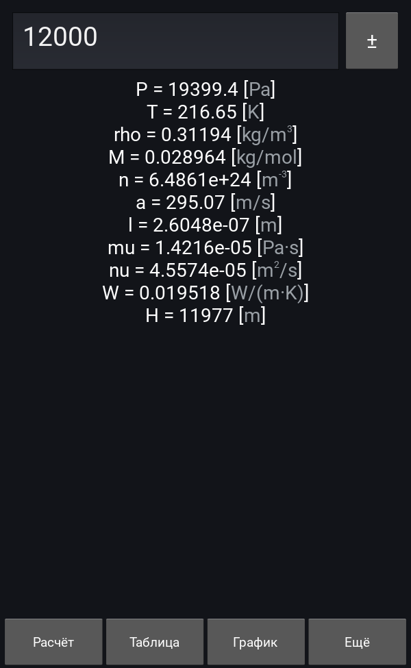
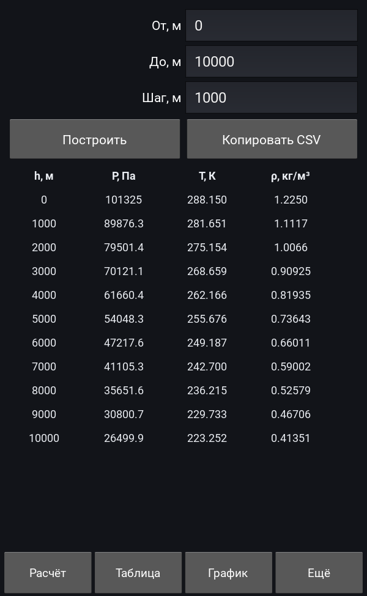
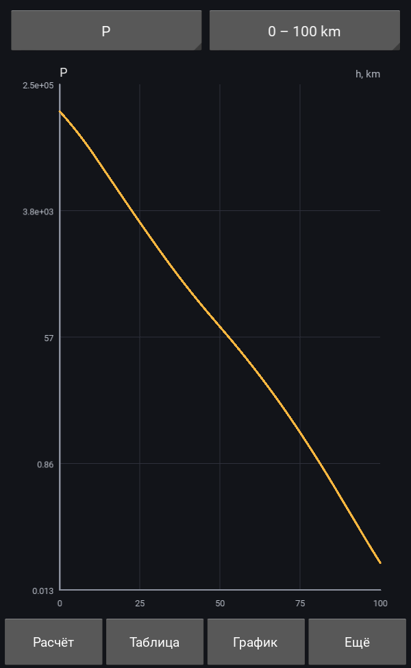

# Std81Atmosphere

App for calculating atmosphere parameters on height according **GOST 4401-81**.

## Features

* single-height calculation of all standard parameters with tap-to-copy;
* table of parameters over a height range, exported to the clipboard as CSV;
* plots of pressure, temperature, density and speed of sound;
* Russian and English interface, the choice is remembered between runs;
* no network access and no permissions.

| Calculation | Table | Plot |
|---|---|---|
|  |  |  |

---

## Project layout

| Path | Purpose |
|---|---|
| `main.py`, `atmo.kv` | Kivy application (calculation, table and plot screens) |
| `std81/` | calculation core, layer table, formatting, translations, range tables |
| `tests/` | golden tests against the GOST tables and physical invariants |
| `buildozer.spec` | Android build configuration |

The core has no Kivy dependency, so it can be used from scripts:

```sh
python -m std81 1000
```

```python
from std81 import compute
state = compute(1000)
print(state.pressure, state.temperature)
```

---

## Tests

Golden tests compare the calculations with the tables of GOST 4401-81
(1410 reference rows). No third-party packages are required:

```
python -m unittest discover -s tests -v
```

or, if you prefer pytest:

```
python -m pip install -r requirements-dev.txt
pytest -q
```

See [tests/README.md](tests/README.md) for the provenance of the reference data
and the known deviations of the 120-150 km layer.

---

## Continuous integration

GitHub Actions run lint and tests on every push, build a debug APK on demand and
publish a signed APK for every `v*` tag. See [docs/ci.md](docs/ci.md).

---

## Build for Android

1. Create image with **buildozer** according to https://github.com/kivy/buildozer?tab=readme-ov-file#buildozer-docker-image

2. Run container with **buildozer**:
```
docker run --interactive --tty --rm --volume "$HOME/.buildozer":/home/user/.buildozer --volume "$PWD":/home/user/hostcwd --entrypoint /bin/bash kivy/buildozer
```
3. Set key if already exists:
```
export P4A_RELEASE_KEYSTORE=...
export P4A_RELEASE_KEYSTORE_PASSWD=...
export P4A_RELEASE_KEYALIAS_PASSWD=...
export P4A_RELEASE_KEYALIAS=...
```
If it doesn't exist, create it with `keytool` (https://gist.github.com/Guhan-SenSam/fa4ed215ef3419e7b3154de5cb71f641)

4. Run build:
```
buildozer android release
```

---

Note:
 - You don't need a key for the debugging build.
 - In WSL you may need to fix the folder `$HOME/.buildozer` rights.
